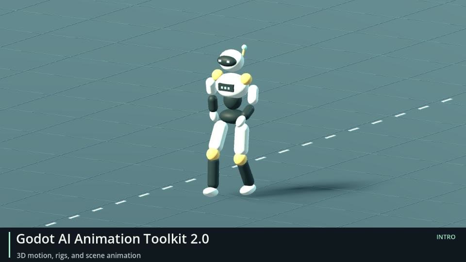

# Godot AI Animation Toolkit

[](https://github.com/michaltomczykowski/godot-ai-animation-toolkit/releases/download/v2.0.0/godot-ai-animation-toolkit-2.0.0-showcase.mp4)

[**Watch the 2.0.0 showcase (4:15)**](https://github.com/michaltomczykowski/godot-ai-animation-toolkit/releases/download/v2.0.0/godot-ai-animation-toolkit-2.0.0-showcase.mp4)

**Chapters** · 0:00 Intro · 0:05 3D Presets · 0:37 3D Motion ·
1:49 3D Rigs and Workflows · 2:57 2D Lamplight Relay · 4:09 Run the Showcase

Give your Godot AI agent animation tools in the running Godot editor. Generate
clips, animate UI and characters, build AnimationTrees, edit existing motion,
and inspect the results. The toolkit registers **10 tool families with
103 operations** and creates native Godot scenes, clips, tracks, and resources.

[Download 2.0.0](https://github.com/michaltomczykowski/godot-ai-animation-toolkit/releases/tag/v2.0.0)
· [Try the showcase](#run-the-godot-showcase)
· [Read the agent guide](#agent-workflow)
· [Browse all operations](docs/op-index.md)

## What you can do

| Family | What it does |
| --- | --- |
| Presets | Animate bounces, pulses, orbits, spins, staggered entrances, and more. |
| FX | Add camera feedback, hit flashes, counters, progress fills, sprite animation, and audio cues. |
| Motion | Generate humanoid idle, walk, run, strafe, jump, turn, starts and stops. Set up locomotion or bake secondary motion. |
| Sequences | Compose existing 3D clips and saved poses with timed fades and contact markers. |
| Rigs | Build bone chains, save and apply poses, generate pose-driven clips, and bake final poses. |
| Rig modifiers | Configure IK, spring bones, look-at, retarget, and twist modifiers. |
| Graphs | Build AnimationTree state machines, blend spaces, locomotion, and layers. |
| Editing | Retime, trim, split, merge, mirror, retarget, resample, or clean up existing tracks. |
| Library | Reuse named templates and exchange typed JSON clip specs. |
| Inspection | Read timelines and rig profiles, audit tracks and motion, sample bones, and render posed previews. |

2.0.0 makes **Responsive** the default for new humanoid motion. Grounded,
Relaxed, Heavy, and Sneaky are available as explicit styles. Regenerating a
clip can change motion and timing, so keep a saved copy before replacing it.
See the [2.0.0 migration guide](docs/migration-2.0.0.md) and
[release notes](docs/releases/2.0.0.md) for the upgrade details.

## Install

1. Use **Godot 4.7.2 stable** and install **Godot AI 4.4.2 or later stable**
   in your project. The release qualification uses Godot AI 4.4.2 on Windows
   and Linux. [Godot AI 4.4.2](https://github.com/hi-godot/godot-ai/releases/tag/v4.4.2)
2. Download `godot-ai-animation-toolkit-2.0.0.zip` and verify it against the
   release SHA-256 file. Extract it into your project root so
   `addons/godot_ai_animation/plugin.cfg` sits beside the other addons under
   `addons/`.
3. In **Project → Project Settings → Plugins**, enable **Godot AI** and
   **Godot AI Animation Toolkit**. Either enable order works.
4. In the Godot AI dock, configure your MCP client. Open the dock's **Tools**
   tab and check the families you need under **Custom tools (addon-registered)**.
   Enablement applies immediately and persists per project.

The installation ZIP contains the toolkit addon and its MIT license.
Get Godot AI separately. The demo scenes and their saved clips come with
the repository source, and the showcase video is a separate release asset.

## Run the Godot showcase

1. Get this repository's source for `v2.0.0`.
2. In its `test_project/addons/` folder, install Godot AI 4.4.2 and copy
   `addons/godot_ai_animation/` from the repository root. On Windows, a checkout
   of the Godot AI source can also be linked with
   `./tools/setup_dev.ps1 -GodotAiPath C:\path\to\godot-ai`.
3. Import [the test project](test_project/project.godot) in Godot 4.7.2. In
   Godot's FileSystem dock, open
   [`res://showcase_2_0/showcase.tscn`](test_project/showcase_2_0/showcase.tscn)
   and press **F6** to run the current scene. Choose a chapter or replay it.
   The gallery starts with 3D props, motion styles, and rig workflows. In the
   2D Lamplight Relay chapter, try **Dispatch relay** and replay the harbor
   scenes. Open the saved examples in the editor to inspect their tracks.

## Limitations

- **Known Linux editor issue.** An intermittent crash was observed during scene
  save in stock Godot 4.7.2 on Linux. Windows and Linux passed the release
  clean-install checks, and the official Linux rendered-preview run passed.
  The intermittent crash remains unresolved. Save incremental checkpoints
  when editing important scenes.
- **Character motion.** Procedural locomotion targets humanoid rigs on level
  surfaces. It generates animation. Gameplay movement and collision belong to
  your game code. Preview the result on your own rig.
- **Interpolation and ownership.** Some track types, overlapping sequence fades,
  and incompatible root-motion changes are rejected. Inspect actual scene
  ownership, resources, and tool diagnostics before editing.
- **Rendered previews and Undo.** PNG previews need a rendering-capable editor.
  Supported scene changes use editor Undo/Redo. A scene save, profile export,
  template write, or other disk effect needs separate file-level recovery.

[MIT license](LICENSE) · [Tool reference](docs/tool-reference.md) ·
[Operation inventory and limitations](docs/operation-audit.json)

## Agent workflow

Use the live Godot AI tools to read the edited scene and work in small,
verifiable steps. The [generated parameter index](docs/op-index.md) and the
active project's advertised schemas are the references for exact operation
inputs.

### 1. Discover tools in the correct editor

1. Confirm which Godot project and editor session the user wants. When there
   are several, list them with `session_manage` and `{"op":"list"}`, then
   select the correct `session_id` with `session_activate`.
2. Call `custom_manage` with `{"op":"list"}`. Read each returned family name
   and its `params_schema`. Use the available `custom_animation_*` tools
   for direct calls. Use the nested `custom_manage` invocation described below
   for `animation_sequence` and `animation_rig_modifiers`.
3. When a tool is missing, check plugin enablement, the supported stable
   Godot AI version, the active session, and the family checkbox in the
   Godot AI dock. Refresh the MCP client tool list after changing a checkbox.
   The dock's built-in animation domain setting controls core tools. The
   per-family checkboxes control the toolkit.

If the catalog is empty, verify that a Godot editor session is active. A cached
tool may return `CUSTOM_TOOL_DISABLED` after that family is turned off.

### 2. Resolve the scene, player, and targets

- Call `scene_open` with the project-relative `res://` scene file path when
  you need to switch scenes. Confirm the reported switch and call
  `scene_get_hierarchy` before editing.
- Use the real root-qualified node paths returned by the hierarchy.
  `player_path` points to an existing `AnimationPlayer`. Use
  `skeleton_path` for a `Skeleton3D` and `tree_path` for an
  `AnimationTree`.
- For preset and FX clip tracks, resolve relative target paths from the
  player's animation root. For example, a target sibling named `Target2D`
  can use `"target_path": "Target2D"` when the animation root is the
  player's parent. Read the scene and player configuration before choosing a
  path. For tools that read named libraries, preserve the full `library/clip`
  key shown by inspection.
- Inspect existing clips with `describe` or `timeline`. For a humanoid rig,
  start with `rig_profile` and `save: false`. Check unresolved tracks,
  detected bone roles, and active AnimationTrees before you write.

### 3. Dry run, then author a clip

These requests show MCP tool names and argument objects. For a disposable
example, duplicate `repair_presets_fixture.tscn` in the test project as
`readme_presets.tscn`, keeping its root name, then open the copy.

```json
{
  "tool": "scene_open",
  "params": {"path": "res://readme_presets.tscn"}
}
```

```json
{
  "tool": "custom_animation_presets",
  "params": {
    "op": "bounce",
    "player_path": "/RepairPresetsFixture/AnimationPlayer",
    "target_path": "Target2D",
    "animation_name": "audit_bounce",
    "intensity": 0.2,
    "dry_run": true
  }
}
```

Read the result before committing. For operations that advertise `dry_run`,
the dry run leaves the scene and disk unchanged. When the result matches
the request, repeat the call with `dry_run` omitted, leaving `overwrite`
off unless the user wants to replace the existing clip. Inspect the result.

```json
{
  "tool": "custom_animation_inspect",
  "params": {
    "op": "describe",
    "player_path": "/RepairPresetsFixture/AnimationPlayer",
    "animation_name": "audit_bounce"
  }
}
```

Editing uses the same inspect/dry-run/write loop. In a copy of
`repair_edit_fixture.tscn`, the `walk` clip is on the
`/RepairGraphFixture/AnimationPlayer`. This request checks a change to its
timing.

```json
{
  "tool": "custom_animation_edit",
  "params": {
    "op": "retime",
    "player_path": "/RepairGraphFixture/AnimationPlayer",
    "animation_name": "walk",
    "factor": 0.5,
    "dry_run": true
  }
}
```

### 4. Compose or configure through the addon catalog

With `custom_manage`, the outer `op` is `invoke`. Its `params` contains
`tool_name` and a second `params` object with the family operation and
inputs. The family name here is the registered name without the
`custom_` prefix.

For a copy of `repair_sequence_fixture.tscn` with its original node names
and approach and kick clips, check a two-segment composition.

```json
{
  "tool": "custom_manage",
  "params": {
    "op": "invoke",
    "params": {
      "tool_name": "animation_sequence",
      "params": {
        "op": "compose",
        "player_path": "/RepairSequenceFixture/AnimationPlayer",
        "skeleton_path": "/RepairSequenceFixture/Skeleton3D",
        "animation_name": "audit_action",
        "duration": 1.8,
        "segments": [
          {"start": 0.0, "duration": 1.0, "source_animation": "approach"},
          {
            "start": 0.8,
            "duration": 1.0,
            "source_animation": "kick",
            "fade_in": 0.2,
            "contacts": [{"name": "impact", "time": 0.3}]
          }
        ],
        "dry_run": true
      }
    }
  }
}
```

For a copy of `repair_rig_fixture.tscn`, check a two-bone IK setup using
the reference rig's arm chain. The modifier is configured inactive so you can
review its wiring before enabling it.

```json
{
  "tool": "custom_manage",
  "params": {
    "op": "invoke",
    "params": {
      "tool_name": "animation_rig_modifiers",
      "params": {
        "op": "ik_setup",
        "skeleton_path": "/RepairRigFixture/Dummy/Skeleton3D",
        "kind": "two_bone",
        "chain": ["B-upperArm.L", "B-forearm.L", "B-hand.L"],
        "target_name": "AuditHandTarget",
        "active": false,
        "dry_run": true
      }
    }
  }
}
```

For motion, secondary motion, and sequence dry runs or writes, pause or stop
the destination player and deactivate its linked AnimationTrees. For a
root-motion sequence, use one player and compatible source clips. Verify who
applies translation in gameplay before changing extraction. If the actor
controller consumes extracted deltas, keep it as the only translation owner.

### 5. Play, inspect, undo, and save

1. Check the tool response and inspect the actual result. Verify track paths,
   expected length, key timing, clip names, and graph parameter paths.
2. Play the clip in the editor or run a disposable copy of the scene.
   Scrub the start, end, transitions, and any loop seam. For character motion,
   check contacts and root travel against the user's intent. Use numeric
   `sample` or `motion_audit` where applicable and render `preview` in a
   graphical editor when a visual comparison is useful.
3. If you need to revert a supported scene edit, use the scene's editor
   **Undo** action, then inspect again. Back up disk files separately for
   library, export, profile, preview, and save operations.
4. Save the intended scene with `{"tool":"scene_save","params":{}}`.
   Confirm that it succeeded and named the expected scene. To verify the
   saved copy, call `scene_open` with its `res://` path and
   `force_reload: true`, then describe and play the clip again. Force reload
   discards unsaved in-memory edits, so confirm the save or preserve those
   edits first.
5. Report the scene path, affected nodes or clips, what you checked in
   playback, and any remaining limitation.

| If you hit this | What to check |
| --- | --- |
| Wrong node, broken track, or clip missing | Re-read the scene hierarchy, animation root, registered paths, and full library/clip key. |
| Unsupported tracks or invalid values | Inspect the original clip and choose an operation whose contract supports its tracks. Preserve the original and revise the request using the diagnostic. |
| Shared library or instanced resource | Confirm the intended scene owns the change. Work on a copy or a local resource where isolation is required, and verify the original scene after saving. |
| Busy player, active tree, or extraction conflict | Pause playback, disable the linked tree, or author on a separate inactive player. Validate translation ownership after re-enabling playback. |
| Preview unavailable in headless mode | Use a graphical Godot editor for PNGs. Use `timeline`, `sample`, or `motion_audit` for numeric checks where applicable. |
| Linux editor closes during save | Reopen the project and inspect the last saved scene and editor log before retrying any write. |
